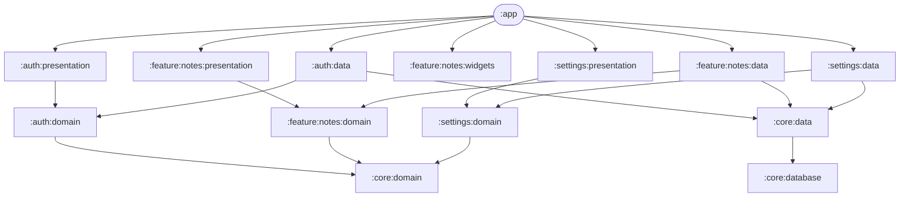
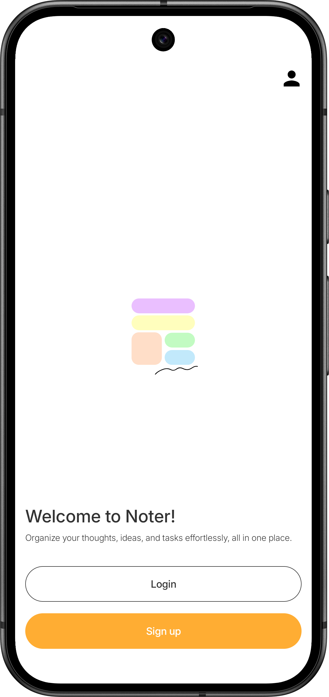
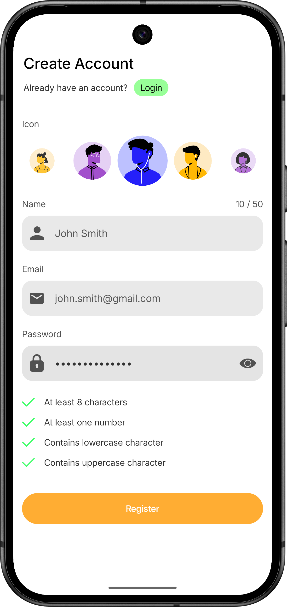
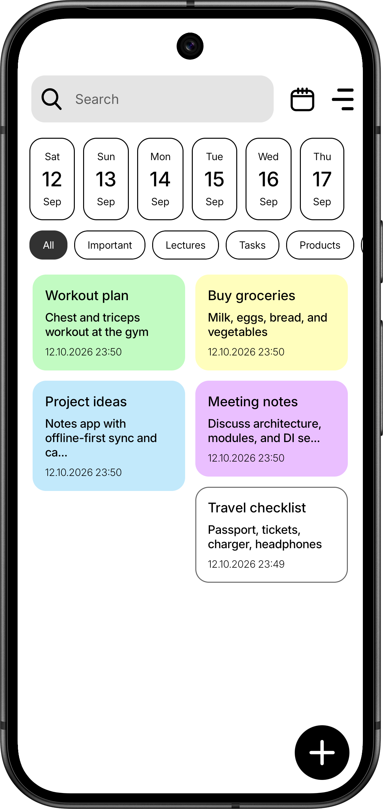
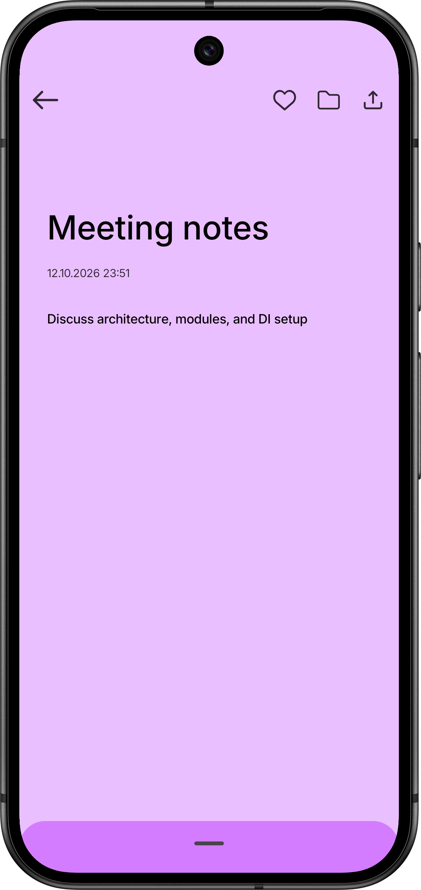
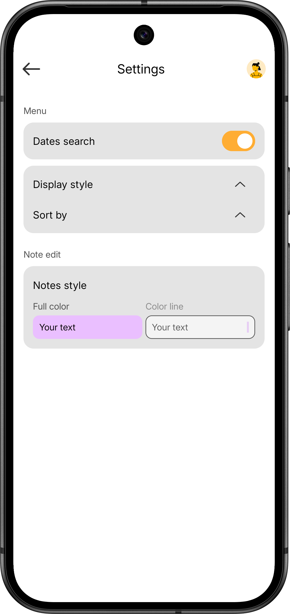
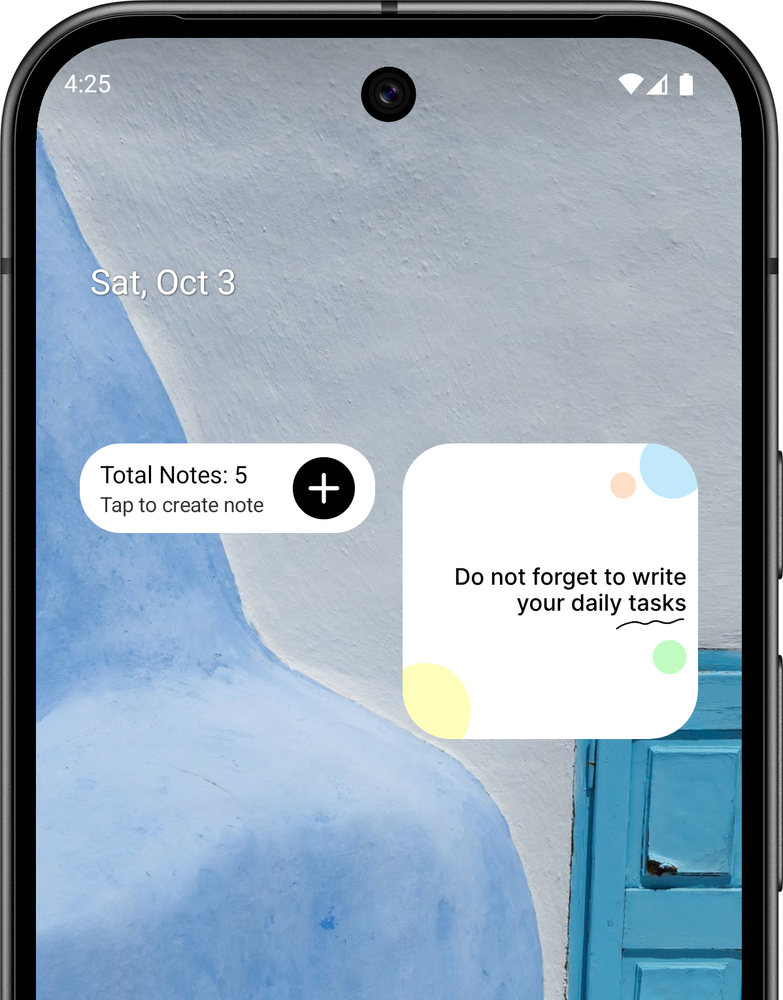

# 📝 Noter — Production-Grade Multi-Modular Android Architecture Showcase

---

## 🎯 Executive Summary

**Noter** is a production-grade, enterprise-ready Android application engineered to demonstrate skills over modern Android development. Built from the ground up to showcase **scalability, maintainability, and clean code principles**.

---
## 🏛️ Architectural Excellence & Multi-Modular Design

Noter implements strict **Separation of Concerns (SoC)** and **Dependency Inversion Principle (DIP)** across **16 isolated Gradle sub-projects**. Presentation modules depend strictly on Domain use cases, while Data modules implement Domain repository interfaces, ensuring zero circular dependencies.

### 🧩 Module Breakdown
| Layer | Sub-Projects / Modules | Responsibility |
| :--- | :--- | :--- |
| **App Shell** | `:app` | Application entry point, global navigation graph, Koin DI initialization, theme configuration. |
| **Feature: Auth** | `:auth:data`, `:auth:domain`, `:auth:presentation` | Authentication flow, account management, and session state persistence. |
| **Feature: Notes** | `:feature:notes:data`, `:feature:notes:domain`, `:feature:notes:presentation`, `:feature:notes:widgets` | Core note CRUD, multi-folder mapping, search filtering, rich text alignment, and home screen widgets. |
| **Feature: Settings** | `:settings:data`, `:settings:domain`, `:settings:presentation` | App preferences, sort order customization, display density, and session management. |
| **Core Foundations** | `:core:data`, `:core:database`, `:core:domain`, `:core:presentation:designsystem`, `:core:presentation:ui` | Shared database abstractions, Room DAO implementations, type converters, domain models, and design system components. |

---

## 🚀 Key Technical Highlights & Engineering Decisions

- **Strict Clean Architecture**: Domain models and use cases are 100% pure Kotlin with zero Android framework dependencies, maximizing testability and business logic reusability.
- **Reactive Data Streams (Kotlin Flow & Coroutines)**: Asynchronous UI updates driven by state flows, debounced search queries (`snapshotFlow`), and reactive database queries.
- **Advanced Room Database Persistence**: 
  - Foreign key constraints with `ON DELETE CASCADE` ensuring referential integrity between accounts, folders, notes, and cross-references (`note_folders`).
  - Transaction-safe upserts (`withTransaction`) guaranteeing synchronization between note entities and folder memberships.
- **Dependency Injection (Koin)**: Modularized dependency graphs declared cleanly per module using Koin's constructor injection (`singleOf`, `viewModelOf`).
- **Declarative UI (Jetpack Compose)**: Custom animated content transitions, full-screen custom dialogs (`FullCalendarDialog`, `FolderSelectionDialog`), and adaptive Compose layouts adhering to Material Design 3 guidelines.

---

## 📸 Feature Tour & Screenshots

| Onboarding & Account Management | Authentication & Login |
| :---: | :---: |
|  |  |
| *Onboarding flow & accounts* | *Secure local authentication & login* |

| Notes Overview & Folder Filters | Note Editor & Customization |
| :---: | :---: |
|  |  |
| *Card & list views, calendar row, & folder chips* | *Rich text alignment, color themes, & multi-folder assignment* |

| Settings & Preferences | Home Screen Widgets |
| :---: | :---: |
|  |  |
| *Personalization, sorting, & date filters* | *Quick access launchers & Glance widgets* |

---

## 🛠️ Tech Stack

- **Language:** Kotlin (2.0+)
- **UI Toolkit:** Jetpack Compose & Material 3
- **Architecture:** Clean Architecture + Multi-Modular Gradle Setup
- **Local Persistence:** Room Database (SQLite with Transactions & Foreign Keys)
- **Asynchronous Programming:** Kotlin Coroutines & Flows (`StateFlow`, `SharedFlow`, `Flow`)
- **Dependency Injection:** Koin
- **Navigation:** Jetpack Navigation (Type-safe Compose navigation routes)
- **Widgets:** Glance
